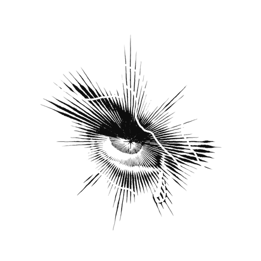
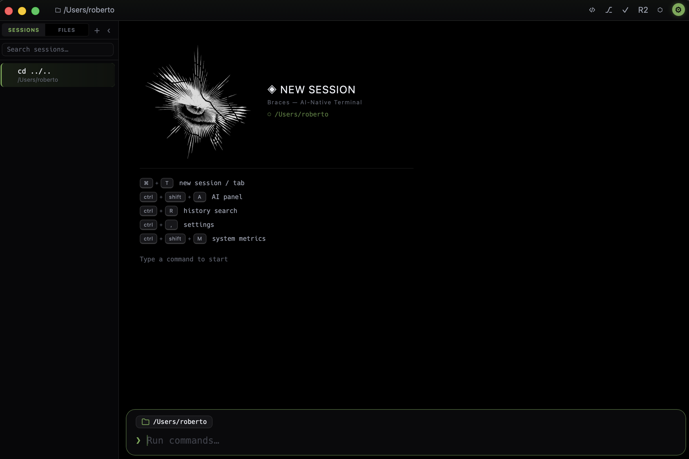

<table>
<tr>
<td></td>
<td>

```
  ██████╗ ██████╗  █████╗  ██████╗███████╗███████╗
  ██╔══██╗██╔══██╗██╔══██╗██╔════╝██╔════╝██╔════╝
  ██████╔╝██████╔╝███████║██║     █████╗  ███████╗
  ██╔══██╗██╔══██╗██╔══██║██║     ██╔══╝  ╚════██║
  ██████╔╝██║  ██║██║  ██║╚██████╗███████╗███████║
  ╚═════╝ ╚═╝  ╚═╝╚═╝  ╚═╝ ╚═════╝╚══════╝╚══════╝
                   ⬡  Terminal
```

</td>
</tr>
</table>

> An AI-native terminal for your desktop. Every command becomes a card, and an AI agent lives right next to your shell.

---

## Why Braces?

I built Braces because I wanted a terminal experience like Warp's — command blocks, an AI agent, a modern feel — but without being tied to a specific machine. Warp relies on GPU acceleration, which means it doesn't run well (or at all) on older hardware, low-power devices, or remote/VM setups without a GPU. Braces is built to deliver that same experience anywhere, on any computer, with no GPU acceleration required.

---

## What is Braces?

Braces is a modern terminal where each command you run appears as its own card — with exit status, elapsed time, and clean colored output. No more scrolling through a wall of text to find where a command started or whether it failed.

On top of that, a built-in AI panel can explain errors, suggest fixes, run commands for you, and review your code — without ever leaving the terminal.

Works on **Windows, macOS, and Linux**.

<p align="center">
  
</p>

<p align="center"><em>This is what Braces looks like — and it comes with 5 different themes to match your style.</em></p>

---

## Highlights

**🧱 Commands as cards** — every command shows a ✓/✕ status badge, how long it took, and the directory it ran in. Failed commands are easy to spot at a glance.

**🤖 AI at your side** (`Ctrl+Shift+A`) — chat with an AI agent that can run shell commands, analyze the last error (`▲`), and inject a one-click fix (`⚡`) into your input. Supports multiple conversations, all saved across restarts.

**🔌 Bring your own AI** — works with Anthropic, OpenAI, Gemini, xAI/Grok, or fully local models via Ollama and LM Studio. API keys are encrypted and stored in your OS keychain, never in plain text.

**📝 Built-in code editor** (`Ctrl+E`) — a full editor with file tree, tabs, syntax highlighting, and live git gutters. Edit, save (`Ctrl+S`), and get back to your shell.

**🌿 Git without leaving** — a live branch/status pill in the command bar, a full git panel (`Ctrl+Shift+G`) to stage, discard, diff, and commit, plus an AI code review panel (`Ctrl+Shift+R`).

**🖥️ Real terminal underneath** — full-screen apps like `vim`, `htop`, `ssh`, `tmux`, or `lazygit` just work: Braces detects them and hands over the pane automatically, then returns to card mode when they exit.

**⚡ Claude Code friendly** — run `claude` inside Braces and it behaves natively, with `Shift+Enter` for newlines and clipboard image pasting built in.

**Also included:** multi-tab sessions, tab completion, history panel with inline suggestions (`↑` / `→`), semantic history search (`Ctrl+R`), clickable URLs (`Ctrl+Click`), system metrics overlay (`Ctrl+Shift+M`), 5 themes, Spanish/English UI, and session persistence — your tabs and chats come back after a restart.

---

## Getting started

### Prerequisites

- [Rust](https://rustup.rs) 1.80+
- [Node.js](https://nodejs.org) 20+ and [pnpm](https://pnpm.io)
- On Windows: [VS Build Tools](https://visualstudio.microsoft.com/visual-cpp-build-tools/) with the C++ workload

### Run it

```sh
pnpm install       # install dependencies
pnpm tauri dev     # run in development mode
pnpm tauri build   # build for production
```

On first launch, a setup wizard walks you through choosing your AI provider, shell, and theme. That's it.

### Opening the app on macOS

The app is not notarized, so macOS will block it on first launch ("Braces is damaged and can't be opened"). Fix it by removing the quarantine flag after copying it to `/Applications`:

```sh
xattr -cr /Applications/Braces.app
```

---

## Keyboard shortcuts

| Shortcut | Action |
|---|---|
| `Ctrl+Shift+A` | AI panel |
| `Ctrl+E` | Code editor |
| `Ctrl+Shift+G` | Git panel |
| `Ctrl+Shift+R` | AI code review |
| `Ctrl+Shift+E` | File explorer |
| `Ctrl+Shift+M` | System metrics |
| `Ctrl+Alt+T` / `Ctrl+W` | New / close tab |
| `Ctrl+Tab` / `Ctrl+Shift+Tab` | Next / previous tab |
| `Ctrl+R` | Search command history |
| `↑` / `→` | History panel / accept suggestion |
| `Ctrl+L` | Clear terminal |
| `Ctrl+,` | Settings |
| `Escape` | Close any panel |

---

## Good to know (technical)

- **Built with**: [Tauri v2](https://tauri.app) (Rust backend), [SolidJS](https://solidjs.com) + TypeScript frontend, and [xterm.js](https://xtermjs.org) for interactive programs. Every tab runs a real PTY via [`portable-pty`](https://crates.io/crates/portable-pty).
- **Your data lives in** `~/.config/braces/` (macOS/Linux) or `%APPDATA%\braces\` (Windows): `config.toml` (settings), `braces.db` (SQLite — sessions and AI chats), `context.json` (semantic history index).
- **API keys** are encrypted with AES-256-GCM and stored in the OS keychain (Keychain / Credential Manager / Secret Service) — never written to disk in plain text.
- **Type-checking and tests**:

  ```sh
  node node_modules/typescript/bin/tsc --noEmit   # frontend
  cargo check && cargo test                        # backend (from src-tauri/)
  ```

---

## License

MIT
